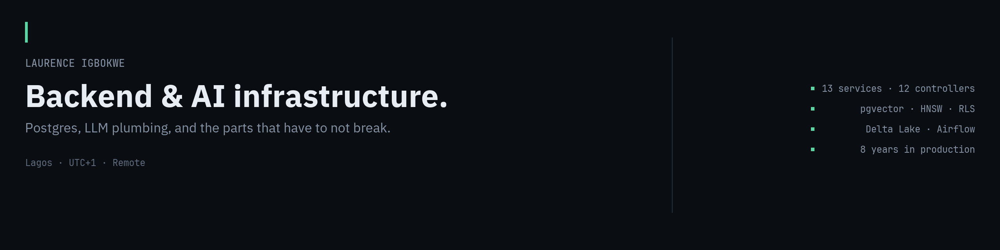

<!--
  github.com/laurence702/laurence702 — profile README
  Repo must be named exactly `laurence702` and be PUBLIC with a README at root.

  Banner: build hero.png in the KX visual system (spec in _ops/social/HERO_CARD_SPEC.md),
  1280×320, commit it to this repo at /hero.png, then the img tag below resolves.

  RULE FOR THIS FILE: every claim is checkable or attributed. No streak widgets,
  no trophy cases, no badge walls, no "connect with me" icon rows. The restraint
  is the signal — this profile is read by people who can tell the difference.
-->

<!--  -->

### Laurence Igbokwe

Backend engineer, eight years. These days I build data pipelines and the plumbing around LLM features: the parts that decide whether something keeps working once real users and real money touch it.

Lagos (UTC+1), remote. Full overlap with European teams, mornings with US East.

**Open to** senior backend, data and AI-infrastructure roles, and short fixed-scope work through Keonix Systems. hello@keonix.dev

---

### Recent public work

| Project | What it does |
|---|---|
| **[olist-cdc-databricks](https://github.com/laurence702/olist-cdc-databricks)** | Change capture from PostgreSQL to Delta Lake on Databricks, without Kafka or Debezium. A 5-minute overlap window catches late-committing rows, and a hash-keyed MERGE makes replays safe. dbt silver layer, 12 tests. `Python · Databricks · Delta Lake · dbt` |
| **[payment-settlement-lakehouse](https://github.com/laurence702/payment-settlement-lakehouse)** | Reconciles synthetic Paystack and Flutterwave-style payment events and flags settlement gaps. Local, production-shaped, no real integration. `Kafka · Spark · Airflow · dbt · ClickHouse` |
| **[QuakeWatch](https://github.com/laurence702/QuakeWatch)** | Medallion lakehouse over live USGS seismic feeds, with magnitude alerts and a map dashboard. `Python · Databricks · Airflow · Delta Lake` |
| **[pgvector-rls-rag](https://github.com/laurence702/pgvector-rls-rag)** | A RAG service that uses Postgres for everything, with no separate vector database. Row-level security sits inside the retrieval query, and recall@k is measured against a golden set. `TypeScript · Postgres · pgvector` |

---

### Client work (not public)

Most of what I have shipped belongs to clients, so here is what I built rather than where:

- Spec-to-SQL migrations with column-level diffs, warnings on destructive changes, rollbacks, and TypeScript types generated from the live schema.
- Webhook ingestion with HMAC verification, retries only for transient failures, and idempotent payments over Paystack.
- GDPR PII masking and retention automation on an ABTA/ATOL-regulated platform.
- A test setup for LLM pipelines: a mock provider so tests need no API calls and run in CI.

---

### Stack

- **Languages:** TypeScript, JavaScript, Python, PHP, SQL, Bash
- **Backend:** Node.js (Express, Fastify, NestJS), Laravel, Deno edge functions
- **Data:** PostgreSQL, pgvector, MySQL, Redis, Delta Lake, Parquet
- **Platform:** Supabase, Cloudflare (Workers, R2, Pages), Docker, AWS, GCP, Firebase
- **AI:** OpenAI, Anthropic, Gemini, RAG, eval harnesses
- **Testing and CI:** pytest, Jest, Cypress, Sentry, GitHub Actions

---

I write about decisions: what I chose, why, and where I would choose differently. Right now it's **Postgres Only**, a five-phase build of a RAG service on Postgres alone.

[LinkedIn](https://www.linkedin.com/in/laurence-igbokwe-166597152) · [keonix.dev](https://keonix.dev)
